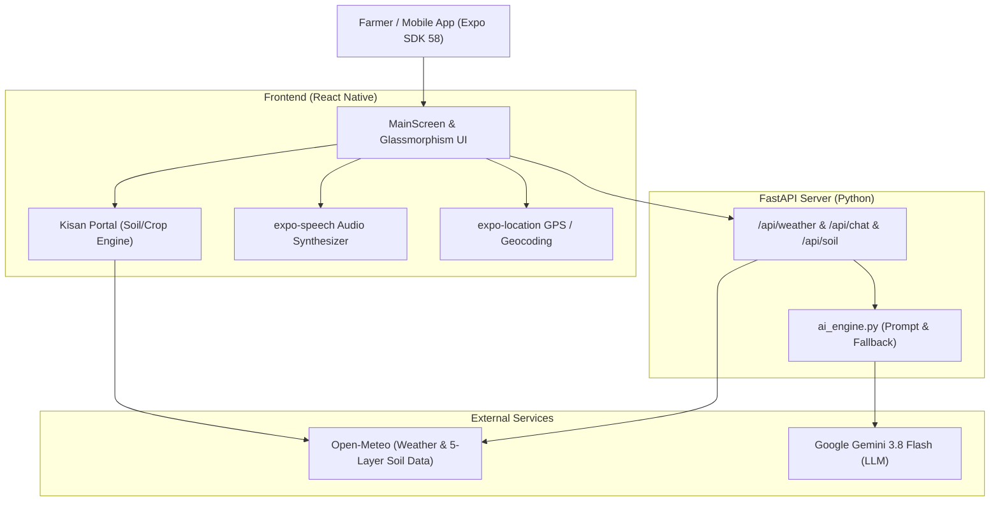

# WeatherGPT: AI-Powered Agricultural Weather & Farm Advisory
## College Project Presentation Deck & 4-Person Script

---

## 👥 Presentation Structure Overview (4 Speakers)

| Speaker | Role | Section | Time (approx.) |
| :--- | :--- | :--- | :--- |
| **Speaker 1** | **Product & Problem Lead** | Introduction, Problem Statement, Why Agriculture, Target Audience | 2.5 mins |
| **Speaker 2** | **Technical & Architecture Lead** | System Architecture, Tech Stack, APIs & Data Pipeline | 2.5 mins |
| **Speaker 3** | **Feature & Innovation Lead** | Key Modules: Dynamic Backgrounds, Multilingual Voice, Kisan Portal | 2.5 mins |
| **Speaker 4** | **Impact, Demo & Future Scope** | Live Demo Walkthrough, AI Safety, Social Impact, Future Roadmap | 2.5 mins |

---

## 📽️ Slide Breakdown & Word-for-Word Scripts

---

### PART 1: The Why & The Problem
**Speaker 1: Product & Problem Lead**

#### Slide 1: Title Slide
- **Slide Title**: WeatherGPT — Hyperlocal AI Weather & Agricultural Advisory
- **Subtitle**: Bridging the Climate Information Gap for Indian Farmers
- **Team Members**: [Member 1, Member 2, Member 3, Member 4]
- **Department**: Department of Computer Science & Engineering

> **Speaker 1 Script:**
> *"Respected professors, evaluators, and fellow students. Today, our team is proud to present **WeatherGPT**, an end-to-end mobile and AI platform engineered specifically to tackle one of the most critical challenges of our nation: agricultural vulnerability to climate volatility.*
>
> *Over 58% of rural India depends on agriculture, yet millions of smallholder farmers still make high-stakes farming decisions based on outdated intuition or generic television broadcasts. WeatherGPT transforms complex meteorological and soil telemetry into actionable, voice-enabled farm advisories in regional languages."*

---

#### Slide 2: Problem Statement & Motivation
- **The Problem**:
  1. **Generic vs Hyperlocal**: Traditional weather forecasts cover 50–100 km radius circles. A farmer needs field-level data (within 1 km).
  2. **The "Numbers" Barrier**: Saying *"VPD is 2.4 kPa with 18% soil moisture"* means nothing to a farmer. They need to know: *"Should I irrigate today or wait?"*
  3. **Linguistic & Literacy Divide**: Most weather apps are English-heavy and text-heavy, ignoring rural farmers who prefer listening and speaking in their mother tongue.
  4. **Cost of Inaction**: Spraying pesticide right before an unpredicted shower wastes ₹3,000 to ₹8,000 per acre in chemicals and pollutes groundwater.

> **Speaker 1 Script:**
> *"Why did we choose this problem? Climate change is no longer theoretical—it is an economic disaster for smallholder farmers. Erratic rainfall, sudden hailstorms, and extreme heatwaves wipe out entire crop cycles.*
>
> *When we analyzed existing apps, we noticed three fundamental flaws:*
> *First, raw metrics like 'humidity 68%' or 'barometric pressure' don't translate into agricultural actions.*
> *Second, linguistic exclusion: rural farmers communicate through speech in Hindi, Marathi, Telugu, Punjabi, or Tamil, not complex English menus.*
> *Third, weather apps completely ignore **what lies beneath the ground**—soil moisture and root-zone water retention.*
>
> *WeatherGPT was born to bridge this exact gap: converting satellite and telemetry data into simple, actionable agricultural advice."*

---

#### Slide 3: Target Audience & Value Proposition
- **Target Persona**: Small & marginal farmers, rural agricultural workers, local Kisan Mandi operators.
- **Core Value Proposition**:
  - **Zero Confusion**: Color-coded action badges (*"Irrigate"* vs *"Skip"*, *"Safe to Spray"* vs *"Delay"*).
  - **Zero Cost Barrier**: Runs on open, free-tier telemetry APIs without subscription fees.
  - **Audio-First Accessibility**: Voice-guided onboarding and two-way multilingual speech.

> **Speaker 1 Script:**
> *"Our primary user is not a tech enthusiast in an urban high-rise; it is a farmer standing in a paddy field under direct sunlight with muddy hands.*
>
> *Because of this, WeatherGPT is designed around three strict principles:*
> *1. Clarity over complexity: Instant red/green indicators.*
> *2. Voice over text: Audio prompts in native languages.*
> *3. Practical agronomy: Every weather metric is tied to an actionable farming decision.*
>
> *I will now hand over to [Speaker 2], who will walk us through the system architecture and the technology stack powering this solution."*

---

### PART 2: System Architecture & Technical Deep-Dive
**Speaker 2: Technical & Architecture Lead**

#### Slide 4: High-Level System Architecture
- **Client Tier**: React Native & Expo SDK 58 (Cross-platform Android/iOS with zero native crashes).
- **Backend Tier**: FastAPI (Python 3.14 async runtime) with CORS and Pydantic schemas.
- **Telemetry Tier**: Open-Meteo Weather API + Open-Meteo Soil Moisture Telemetry (zero API key overhead).
- **Intelligence Tier**: Google Gemini 3.8 Flash LLM + Multilingual NLP fallback engine.
- **Speech Pipeline**: Native `expo-speech` Text-to-Speech (TTS) + Web Speech/Audio interface.

> **Speaker 2 Script:**
> *"Thank you, [Speaker 1]. On the engineering front, our architecture was built around high availability, low latency, and zero rural friction.*
>
> *Our mobile client is developed using React Native and the modern **Expo SDK 58** runtime. We purposefully engineered a glassmorphic user interface using `expo-blur` and `expo-linear-gradient` to create high-contrast outdoor readability under direct sunlight.*
>
> *Our backend is powered by **FastAPI** on Python 3.14. We opted for an asynchronous ASGI architecture because handling real-time telemetry from multiple satellite endpoints alongside LLM tokens demands non-blocking I/O."*

---

#### Slide 5: The Telemetry Stack (Why Open-Meteo & Soil Metrics?)
- **Open-Meteo Integration (No API Key Required)**:
  - Latitude/Longitude GPS targeting.
  - Multi-depth soil moisture: `soil_moisture_0_to_1cm` (topsoil) and `soil_moisture_9_to_27cm` (root-zone).
  - Atmospheric parameters: `evapotranspiration` (ET) and `vapour_pressure_deficit` (VPD).
- **Past & Future Temporal Coverage**:
  - `past_days=5`: Historical rainfall tracking (prevents over-irrigation if it rained 2 days ago).
  - `forecast_days=7`: Predictive planning for sowing, fertilizing, and harvesting.

> **Speaker 2 Script:**
> *"One of our proudest engineering decisions was eliminating expensive, fragile third-party weather API keys by integrating the open **Open-Meteo Telemetry API**.*
>
> *Most weather apps stop at temperature and rain. WeatherGPT dives beneath the surface: we capture 5 distinct layers of soil moisture, focusing specifically on the **9 to 27 cm root zone**.*
>
> *Why is this crucial? Because if the topsoil looks dry due to midday sun, but the root zone is saturated at 40% moisture, irrigating will suffocate the crop's roots with waterlogging. Conversely, if root moisture drops below 15%, our algorithm flags immediate crop water stress.*
>
> *Furthermore, we extract **Vapour Pressure Deficit (VPD)**. When VPD exceeds 2.0 kPa, plant stomata close to prevent moisture loss, meaning any chemical fertilizer sprayed during that window will scorch leaves and evaporate uselessly.*
>
> *Now, [Speaker 3] will explain how these algorithms power our user interface and multilingual features."*

---

### PART 3: Key Features & Agricultural Innovation
**Speaker 3: Feature & Innovation Lead**

#### Slide 6: Intelligent Kisan Portal & Decision Engines
- **Three Core Agricultural Advisory Cards**:
  1. **Irrigation Advisory**:
     - *Algorithm*: Combines root-zone soil moisture (<15% dry, >35% saturated) + live rain detection + evapotranspiration rate.
     - *Outcome*: Tells the farmer whether to run pumps today or save electricity/water.
  2. **Fertilizer & Chemical Spraying**:
     - *Algorithm*: Evaluates wind gusts, rain probability, humidity (>90% fungal risk), and VPD (>2.0 kPa stress).
     - *Outcome*: Prevents expensive pesticide run-off and crop chemical burn.
  3. **Harvest Readiness**:
     - *Algorithm*: Matches selected growth stage (*Sowing, Growing, Harvest*) with extreme weather alerts and temperature caps (<42°C).
     - *Outcome*: Avoids harvesting right before downpours that rot cut grains in the field.

> **Speaker 3 Script:**
> *"Thank you, [Speaker 2]. All the complex telemetry my teammate just described is synthesized into our **Kisan Portal**.*
>
> *Instead of raw charts, the farmer sees three clear cards:*
> *First, the **Irrigation Card**. If soil moisture in the root zone is above 35%, it displays a red warning: 'Soil is saturated—skip irrigation to prevent waterlogging'. If it's below 15%, it flags an immediate green action badge: 'Irrigate now'.*
> *Second, the **Fertilizer Spraying Card**. It cross-checks wind speed, upcoming rainfall, and Vapour Pressure Deficit. It prevents farmers from spraying chemicals that would wash into rivers or evaporate into thin air.*
> *Third, the **Harvest Readiness Card**. A farmer can toggle crop stages between Sowing, Vegetative, and Harvest. If harvesting conditions are clear, it gives the go-ahead; if a storm is predicted in the 7-day window, it advises holding off.*
>
> *Every card is backed by a localized '🔊 Listen' button that speaks the recommendation aloud in the user's native tongue."*

---

#### Slide 7: Multilingual Inclusivity & Dynamic Visuals
- **7 Supported Regional Languages**:
  - English, Hindi (हिन्दी), Punjabi (ਪੰਜਾਬੀ), Telugu (తెలుగు), Tamil (தமிழ்), Marathi (मराठी), Bengali (বাংলা).
  - Complete parity: Every button, advisory, weather description, and speech readout is localized.
- **Fluid Weather Backgrounds**:
  - Real-time animated canvas adapting to current weather:
    - ☀️ **Sunny**: Golden ray rotations & warm gradient.
    - 🌧️ **Rain**: Fluid falling raindrops with wet reflection.
    - ⛈️ **Storm**: Simulated lightning flashes & dark convective clouds.
    - ⛅ **Cloudy**: Drifting mist & diffused lighting.
    - ❄️ **Snow**: Crystalline particle animation.
- **Global & Local Geolocation**:
  - Auto-tracing via device GPS (`expo-location`).
  - Search modal querying worldwide towns and villages with auto-complete.

> **Speaker 3 Script:**
> *"Accessibility was our highest design priority. India is a subcontinent of languages. WeatherGPT offers 100% full-stack localization across **7 major languages**: English, Hindi, Punjabi, Telugu, Tamil, Marathi, and Bengali.*
>
> *When a farmer selects Punjabi, the entire UI, the crop names, the growth stages, and even the voice assistant immediately transition to Punjabi.*
>
> *To provide instant feedback, we built a **Dynamic Weather Canvas**. If a storm is brewing, the app's background shifts to convective dark skies with animated lightning flashes. If it's clear, warm ambient sunlight reflects across the glassmorphic cards. This visual-first feedback ensures even illiterate farmers can grasp current atmospheric severity at a glance.*
>
> *I will now invite [Speaker 4] to demonstrate the live application, discuss safety protocols, and outline our future roadmap."*

---

### PART 4: Live Demo, AI Safety & Impact
**Speaker 4: Impact, Demo & Future Scope**

#### Slide 8: Live Demonstration Highlights
*(Screen-share or device mirroring running the mobile app & FastAPI backend)*
1. **GPS Detection**: App opens, requests location, and auto-detects current coordinates.
2. **Location Switching**: Tap header (`📍 ... ▾`), search for another city (e.g., *"Ludhiana"* or *"Guntur"*), and observe the weather and background morph dynamically.
3. **Past 5 Days & 7-Day Forecast**: Toggle between historical rainfall and future outlook.
4. **Kisan Portal**: Select *"🌾 Rice"* / *"Harvest"* stage → examine the root-zone soil moisture metrics and tap *"🔊 Listen"*.
5. **AI Agronomist Chatbot**: Ask a contextual agricultural question in a regional language and show the Gemini 3.8 Flash response.

> **Speaker 4 Script:**
> *"Thank you, [Speaker 3]. Let us now look at WeatherGPT in action.*
>
> *[Show Demo]*
> *Notice that as the app launches, it automatically accesses GPS through `expo-location`, detects our coordinates, and calls the Open-Meteo telemetry engine. The background immediately mirrors our current atmospheric conditions.*
>
> *If I open our location search and type 'Ludhiana, Punjab', the entire dashboard transitions. Look at the forecast module below the weather card: we can toggle between the **Past 5 Days** of actual historical precipitation and the **7-Day Predictive Forecast**.*
>
> *Now, switching over to the Kisan Portal tab: we select 'Wheat' in the 'Sowing' stage. The app calculates our 9-to-27 cm root moisture level. If I press '🔊 Listen', our native speech synthesizer reads out the customized advisory in clear regional audio.*
>
> *Finally, our AI Agronomist tab connects to Google Gemini 3.8 Flash, allowing farmers to ask natural questions like 'Should I spray pesticide today?' with full weather-context injection."*

---

#### Slide 9: AI Safety, Limitations & Ethical Guardrails
- **The "AI Hallucination" Danger in Agriculture**:
  - An AI suggesting the wrong chemical dosage can destroy an entire season's livelihood.
- **Safety Architecture in WeatherGPT**:
  1. **Strict Context Injection**: Gemini is strictly bounded by real-time telemetry parameters in its system prompt—it cannot invent weather numbers.
  2. **Rule-Based Circuit Breakers**: Critical irrigation and spraying alerts use hard deterministic mathematical thresholds (VPD > 2.0 kPa, Soil > 35%) before consulting the LLM.
  3. **Permanent Warning Banner**: Prominent yellow banner across all screens: *"AI college prototype. Consult official IMD alerts for emergencies."*
  4. **Graceful Offline Fallback**: If internet connectivity drops or API credits exhaust, the app defaults to built-in deterministic agronomist rule sets without crashing.

> **Speaker 4 Script:**
> *"When deploying Artificial Intelligence in agriculture, safety is not an afterthought—it is life and death. A hallucinated recommendation can bankrupt a farming family.*
>
> *To guarantee safety, we implemented a dual-layer architecture:*
> *First, **deterministic circuit breakers**. Decisions regarding pesticide timing and soil saturation are governed by hard mathematical algorithms based on ICAR (Indian Council of Agricultural Research) principles. The LLM is used to communicate and explain, not to guess physics.*
> *Second, our **offline fallback mode**. In rural areas where connectivity drops, the app gracefully degrades to offline cached advisories, ensuring the farmer is never left without guidance.*
> *Third, a mandatory **IMD safety disclaimer** is visible at all times."*

---

#### Slide 10: Conclusion & Future Roadmap
- **Social Impact**:
  - Water conservation via precision irrigation.
  - Reduced chemical runoff protecting soil health and groundwater.
  - Digital empowerment for non-English-speaking rural communities.
- **Future Enhancements**:
  - IoT LoRaWAN soil-probe hardware integration.
  - Computer vision leaf disease diagnosis (take a photo of diseased leaf for Gemini diagnosis).
  - Voice-to-voice bidirectional conversational streaming via Gemini Live API.

> **Speaker 4 Script:**
> *"To conclude, WeatherGPT is more than a weather app—it is a climate resilience companion for the farmers who feed our country. By combining satellite telemetry, multi-depth soil science, and regional voice AI, we democratize precision agriculture for every smallholder farmer.*
>
> *In our next phase, we aim to integrate edge camera diagnostics for crop pest detection and deploy low-cost physical LoRaWAN soil sensors in college farm plots.*
>
> *We would like to thank our project guide and faculty for their invaluable support throughout this journey. We are now open to questions from the panel. Thank you!"*

---

## 💡 Quick Tips for Q&A (Be Prepared for These Questions!)

1. **"Why use Open-Meteo instead of OpenWeatherMap?"**
   - *Answer*: *"Open-Meteo provides scientific, satellite-derived multi-layer soil moisture (0-1cm, 9-27cm) and agricultural variables (VPD, Evapotranspiration) completely free and open-source without requiring credit-card billing or API keys, making it scalable for college projects and rural deployments."*

2. **"How does the voice feature work without burning mobile data?"**
   - *Answer*: *"Instead of streaming heavy cloud audio files, we use `expo-speech`, which utilizes the native Text-to-Speech engines built directly into Android and iOS devices. This works instantly with near-zero data consumption."*

3. **"What happens if the farmer has an uncommon dialect?"**
   - *Answer*: *"Our UI is designed with high visual affordance—color badges, emojis, and clear numeric icons accompany every voice advisory so visual cues reinforce the spoken word."*
